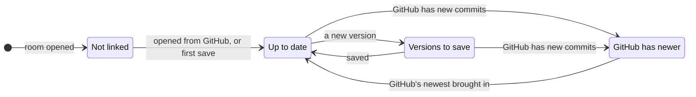

# Games on GitHub

### Opening any game from GitHub, saving the studio's games there, and a demo lobby with a context

Two things make a game studio more useful than one laptop: trying other people's games, and
keeping your own somewhere safe and shareable. This plan connects the Game Studio to GitHub.
**Any game that roughly fits the studio** (a web page with its scripts, run in a browser) can be
opened from a GitHub link and played, and the crew can build on it. **Any game the studio
makes** can be saved to a new repository, and later versions saved to the same one. A game
saved privately carries its **history**, the conversation that made it, so opening it again
picks up where it left off.

The local saves stay as they are: every version is in the laptop's database and its games
folder the moment it's made. That's how a lesson works offline, and how a teacher tries things
before saving them to GitHub. GitHub is an extra layer, and nothing goes there unless someone
presses **Save to GitHub**.

The plan also changes the lobby in demo mode: one button, **Open a demo room**, with a
**Context** to choose, Game Studio by default.

It builds on [Bigger games](bigger-games-2026-11-16.md) Phase A: game folders, the bundle, the
shelf and **Bring in a game**. The words for the room (crew member, run, hail, grant, made thing,
version) are in [`docs/state_machines.md`](../state_machines.md).

## Decisions

Settled on 2026-11-16:

- **Who can see a saved game.** The teacher picks, the first time a game is saved: **Public**
  or **Private**.
  - A **public** repository holds the game, its design notes (`game.md`) and a play link on
    GitHub Pages. The conversation stays on the laptop.
  - A **private** repository holds all of that plus the history, so opening it later picks up
    where it left off.
- **Signing in.** A **Connect GitHub** button, using GitHub's device flow. The app shows a short
  code, and the teacher types it at github.com/login/device. It needs a "Bridge Crew" OAuth app
  registered once on GitHub, with device flow switched on. Its client ID goes in the code, and
  device flow needs no secret. Opening a public game needs no sign-in at all.
- **Demo rooms.** A demo room gets its context's pack for the whole crew. A Deliberation context
  also gets a short scripted opening about its pack, as today's demo room does. A Game Studio
  demo room starts with **New game** or **Open a game**.
- **Order.** First the lobby and opening from GitHub (G1, G2). Then Bigger games Phase B, where
  the Engineer edits with tools. Then connecting and saving to GitHub (G3–G5).

Defaults, not asked:

- **One commit per version.** Saving pushes each version made since the last save as its own
  commit, oldest first, tagged `v1`, `v2`, …. So GitHub's history matches the room's versions.
- **Someone else's game is forked.** Saving changes to a game that came from someone else's
  repository forks it into the teacher's account. The fork keeps a link back to the original,
  which credits its maker.
- **Never overwrite.** If GitHub has commits the room doesn't, saving stops and offers to bring
  GitHub's newest in first, as a new version. The studio never merges.
- **No git on the laptop.** The studio talks to GitHub's API. Nothing to install, pictures and
  fonts are handled, and each version becomes one commit or none.
- **Repo docs stay generic.** The teacher's account and games aren't named in the code or the
  docs, and the app has no built-in list of them. A link is pasted, and the room remembers it.

## Words

- **Repository** (or repo): a project on GitHub, such as `github.com/someone/rocket-lab`.
- **GitHub link**: a room's connection to one repository. A game opened from GitHub, or saved
  there, is **linked**.
- **Save to GitHub**: sends the room's new versions to its linked repository, creating it the
  first time.
- **Open from GitHub**: makes a game in a repository the room's next version.
- **Play link**: the game's GitHub Pages address, such as `someone.github.io/rocket-lab`, where
  anyone can play a public game.
- **History**: the room's conversation, meaning the people's prompts and what the crew said,
  plus the briefs behind what was granted and which version each step made.
- **Restore file**: `bridge-crew/room.json` in a private repository. It holds the history, the
  pictures, sounds and music, and which commit is which version, so a room can be rebuilt.
- **Context**: what a demo room is about. It's a kind of room plus a context pack, such as Game
  Studio, or Deliberation with the Kererū Ferry Co-op pack.

## Part 1: The lobby and demo rooms (G1)

**Demo mode** (`just demo`, with no room kind fixed):

- One button: **Open a demo room**. The separate **Open a room** goes, and so does the **Kind of
  room** choice. The context sets the kind of room.
- **Context**, a list, with **Game Studio** picked by default. Then Kererū Ferry Co-op, NZ
  politics, Social epidemiology and Bridge Crew protocol.
  - Game Studio makes a Game Studio room, with its `game-studio` pack, as today.
  - Each other context makes a Deliberation room. Every station gets that pack, and the room
    opens with that pack's scripted opening. The script lives beside the pack as `demo.md`:
    two or three lines from the people, and one crew member's hail whose brief uses the pack's
    canaries. It's made through the same moves as a real run, as today's demo is. A pack
    without a `demo.md` isn't listed.
- **In a Game Studio demo room:** **Game**, either **New game** or **Open a game**, with a GitHub
  link, a folder or an HTML file. Then **Games**, Simple or Bigger, as Phase A has it. A game
  that needs Bigger switches the room to Bigger, and the lobby says so before the room opens.
- **Once the room is open, the context doesn't change.** The packs show greyed out in the
  Context panel, as they do today.

**The teacher's Desktop shortcut** (`just game-studio`, where the room kind is fixed to Game
Studio): the button stays **Open a room**, since a lesson isn't a demo. There's no Context
list. It gets **New game** or **Open a game** too.

**Outside demo mode** (`just run`), the lobby is unchanged.

**Done when:** in `just demo`, each context opens a demo room with its pack, and each
Deliberation context's opening shows the crew using that pack. A Game Studio demo room can open
a game from a folder at the start. The teacher's shortcut says **Open a room**.

## Part 2: Opening a game from GitHub (G2)

- **The link** can be:
  - a repository (`github.com/owner/repo`, or with `/tree/branch/folder`);
  - a play link (`owner.github.io/repo/`), which maps to its repository;
  - or just `owner/repo`.
- **Where:** **Open a game** in the lobby, and **Bring in a game** on the big screen, which gets
  a **GitHub link** box beside **Choose a folder**.
- **Fetching.** The server downloads the repository's archive, one request for the newest
  commit on its main branch, and unpacks it in memory. Public repositories need no sign-in;
  private ones use the teacher's connection (Part 3). The size limits are Bring in's.
- **Finding the game:**
  1. `index.html` at the top.
  2. Otherwise `docs/index.html`, GitHub Pages' other usual folder.
  3. Otherwise the only HTML page.

  A repository that has to be built first, with a `package.json` and no built page, gets "This
  game needs building first, which the studio can't do yet."
- **Then it's Bring in** (Phase A): Three.js and fonts switched for the shelf's, the rest
  listed, a Simple room asked to become Bigger, and a suggestion to update an older Three.js.
- **Games written as modules.** Many web games, most of Three.js's examples among them, load
  their scripts with `import`. Phase A can't run those, so this part adds it. The bundle builds a
  game's modules into one script with esbuild, which comes with Vite already. It maps `three`
  and `three/addons/…` to the shelf, so the shelf's build also makes a module copy of
  Three.js. This is what "roughly fits" mostly needs.
- **The link stays with the room:** the repository, its branch and the commit it came from. The
  room's header shows "From github.com/owner/repo". When GitHub has newer commits, the room's
  **GitHub** menu offers **Bring in GitHub's newest**, as a new version.
- **A game the studio saved** has a `bridge-crew/` folder, so it opens as more than one version:
  - its versions come back, one per tag (`v1` … `vN`);
  - so do its `game.md`, and its pictures, sounds and music;
  - from a private repository, the history comes back too, as **Earlier sessions** above the
    new session's conversation, to read but not change.

**Done when:** the teacher's four games open from their GitHub links and their play links,
and play on the big screen and in the Tester's browser. A small module-based Three.js game from
GitHub plays too, and a repository that needs building says so.

## Part 3: Connecting GitHub (G3)

- **Registering, once.** Rich, or Onra Systems, registers an OAuth app called "Bridge Crew" on
  GitHub, with device flow switched on and no callback URL. Its client ID goes in
  `src/lib/github.ts`. An adopter can use their own through `BRIDGE_CREW_GITHUB_CLIENT_ID`.
- **Connect GitHub**, in the lobby and in a room's **GitHub** menu:
  1. The server asks GitHub for a device code.
  2. The app shows the code, and opens github.com/login/device in a new tab.
  3. The teacher types the code and approves.
  4. The server waits for GitHub's answer, then shows "Connected as …".
- **The permission is `repo`**, because private repositories need it. It lets the studio write
  to every repository the account has, public and private, so the Connect screen says that
  plainly. A teacher may prefer a GitHub account just for the studio's games.
- **The token** lives in the laptop's database, in a new `github_accounts` table that only its
  own Bridge Crew user can read. It goes only to GitHub: never to the browser, never to
  Anthropic.
- **Disconnect** deletes the token. GitHub only lets an app's owner revoke its tokens, so the
  screen links to github.com/settings/applications, where the teacher can revoke it too.
- On a shared seat, the connection is the teacher's: the signed-in user's.

**Done when:** connecting and disconnecting work against real GitHub, and the token is
nowhere but that table.

## Part 4: Saving to GitHub (G4)

- **The first save** asks for:
  - a repository name, from the room's title;
  - **Public** or **Private** (the decision above);
  - and, for a game that came from someone else's repository, whether to **fork** it. Forking
    is the default.

  Then the studio creates the repository, or the fork, in the connected account.
- **Each save** sends the versions made since the last one. Each becomes its own commit, oldest
  first, through GitHub's API: files, tree, commit, then the branch moves.
  - Each commit is tagged with its version's number.
  - The commit message is the version's name, such as "Version 3: with gems", then the
    Engineer's spoken summary. A brought-in version says where it came from.
  - The room shows "Saved to github.com/owner/repo" and how many versions aren't saved yet.
- **What goes in:**
  - The game folder, with its shelf files under `studio/`, so it plays on GitHub Pages as it
    is.
  - A `README.md`: the title, how to play (from `game.md`), the play link, "Made with Bridge
    Crew", and the shelf's licences.
  - `bridge-crew/game.md`.
  - **A private repository also gets** `bridge-crew/history.md`, the conversation in order with
    each version it made, and `bridge-crew/room.json`, the restore file.
- **A public repository** gets GitHub Pages switched on, and the room keeps its play link. That
  brings the roadmap's "hosting games online" into this plan: a family can get a link as well
  as a file.
- **When GitHub has moved on**, say from someone editing on github.com, saving stops and offers
  **Bring in GitHub's newest** first. When the account can't write to the repository, it offers
  a fork.
- **History never goes into a public repository.** Every save checks the repository's
  visibility first, because it can be changed on github.com. A repository made public later
  keeps its old commits, history included. The users guide says so plainly, and the room warns
  when it sees a once-private repository gone public.

**Done when:**
- a new game saves to a new private repository and to a new public one, and the public one
  plays at its play link;
- a second save adds commits and tags, and leaves the rest untouched;
- one of the teacher's games, changed in the studio, saves to a fork;
- a save refuses when GitHub has moved on.

## Part 5: Picking up where it left off (G5)

- **Opening a game the studio saved privately**, in a new room or on another laptop, brings
  back:
  - its versions;
  - its `game.md`;
  - its pictures, sounds and music, already in use;
  - and its history, as **Earlier sessions**.

  The room is linked to the repository, so the next save carries on from there.
- **The history file** (`history.md`) is for people. It reads like the room's conversation: who
  asked what, what the crew said, and which version came of it. Students appear by nickname,
  as they do in the room.
- **The restore file** (`room.json`) is for the studio, and carries a format version so it can
  change later. Tests and their pictures stay on the laptop, because they're big and belong to
  one version.

**Done when:** a game saved privately, its room deleted, opens again from its link with its
versions, notes, pictures, sounds, music and history.

## Part 6: The GitHub link's state

The room's link to GitHub is a new thing with state, so `docs/state_machines.md` gets its
machine in the phase that builds it.

- **GitHub has newer** is checked when the room opens and before every save. It takes one
  request.
- From **GitHub has newer**, saving is refused until GitHub's newest is brought in. Bringing it
  in makes it a new version, so the room then has versions to save again.
- With no internet, the room keeps working, and the link's state waits until GitHub answers.

## Phases

One pull request per phase, in this order. Sizes are relative.

| Phase | What | Size | Needs |
| --- | --- | --- | --- |
| G1 | The lobby and demo rooms (Part 1), and a `demo.md` for each Deliberation pack | M | Bigger games Phase A merged |
| G2 | Opening a game from GitHub, and games written as modules (Part 2) | M | G1 |
| — | Bigger games Phase B: the Engineer edits with tools | L | |
| G3 | Connecting GitHub (Part 3) | S | The "Bridge Crew" OAuth app, registered |
| G4 | Saving to GitHub, with history in private repositories, forks and play links (Part 4) | L | G3 |
| G5 | Picking up where it left off (Part 5) | M | G4 |

Each phase keeps `docs/users_guide.md`, the teacher's guide and `docs/state_machines.md` in
step. G4 and G5 are tested against real GitHub, in a test account's throwaway repositories,
because GitHub's API can't be faked well enough to trust.

## Not in this plan

- Merging changes made in two places. The studio brings GitHub's newest in as a version
  instead.
- Pull requests, branches other than the main one, and GitHub Classroom or organisations for a
  class.
- Games that need building (`npm run build`), and large media such as videos.
- Other hosts, such as GitLab.
- Deleting or renaming repositories from the studio.

## For the pre-launch legal discussion

- A private repository holds a student's words and nickname on GitHub's servers, outside New
  Zealand, and a public one holds their game. Both need covering in the classroom notice and in
  the family's agreement. The legal adviser should look at both.
- Whose GitHub account student games live in: the teacher's own, or a school's.
- A licence for the games students make, which decides what others may do with a public game.
  The studio adds none for now.
- Forking other people's games is allowed on GitHub. Reusing one outside GitHub depends on its
  licence, and the teacher's four have none.

## Risks

- **A broad permission.** `repo` reaches every repository the teacher has. Mitigated by saying
  so on the Connect screen, suggesting an account just for the studio, and Disconnect. A GitHub
  App with narrower, expiring tokens could replace it later, if GitHub confirms such an app can
  create a user's repositories.
- **History made public by accident.** A private repository switched to public on github.com
  publishes its old commits. Mitigated by the visibility check, the warning, and the users
  guide.
- **A token on the laptop.** It sits in the local database, readable only by its own Bridge Crew
  user, on a laptop the teacher controls. Disconnect removes it.
- **Games that don't fit.** Some will need a build step, a server, or libraries the shelf doesn't
  have. The studio says which, and the rest is on the roadmap.
- **GitHub's limits.** Opening public games without signing in is limited to 60 requests an
  hour from one network. Opening a game takes a few requests, and signing in raises the limit.

---
*Iteration 1, written 2026-11-16 from the project lead's notes. A companion to
`bigger-games-2026-11-16.md`.*
