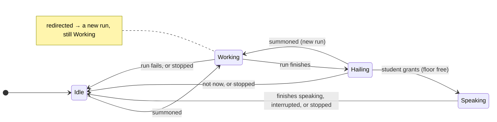
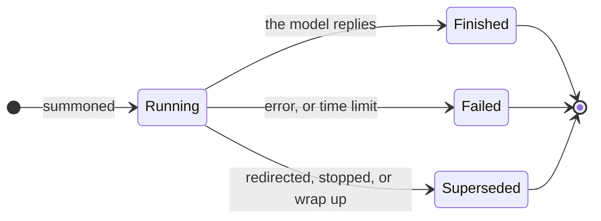
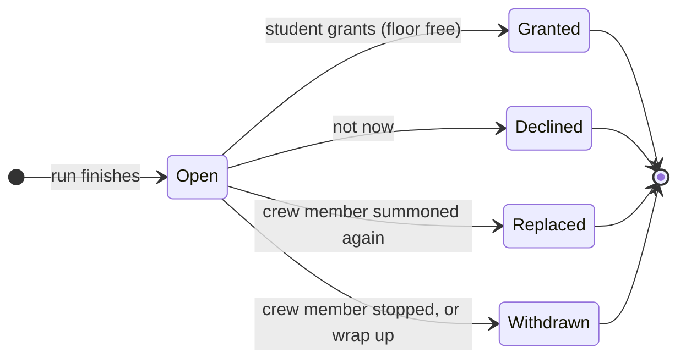
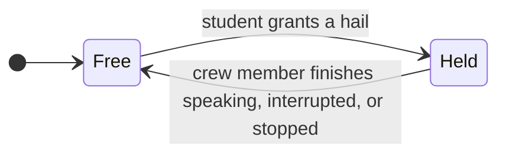
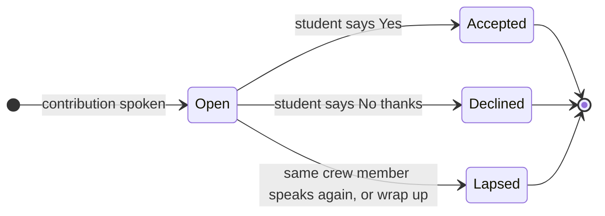
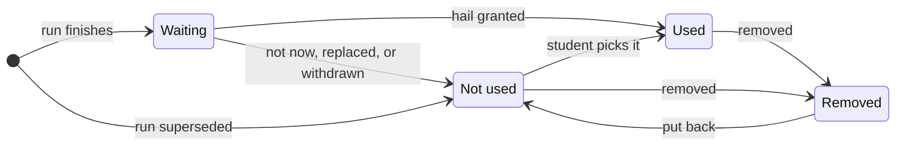
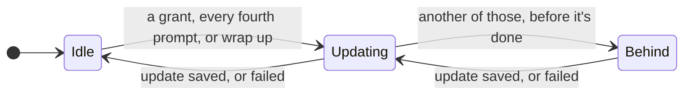
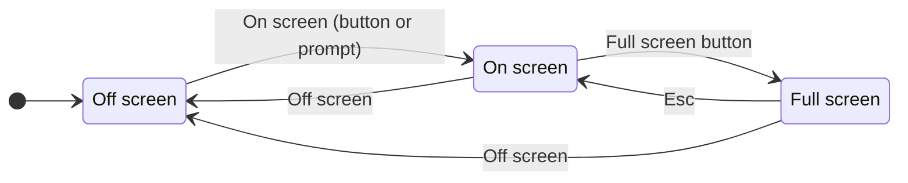
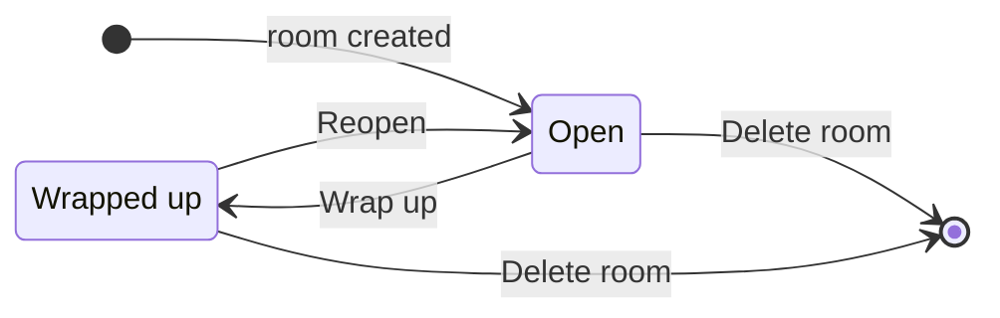
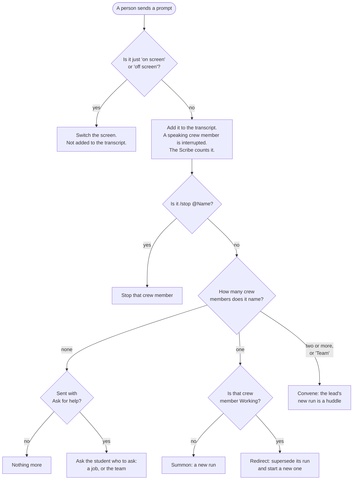

# Bridge Crew state machines

Bridge Crew is an app in which people work with a team of AI characters. This document covers
everything in a room that has a state: which states it can be in, which events move it, and what
each event changes elsewhere. It's written for developers and teachers, and it has three uses:
planning features, writing tests (the rules in Section 14 are what the tests check), and writing
the user and teacher guides.

Every word with a special meaning is defined in Section 1 before anything else uses it. Most
examples come from the Game Studio, the room for teaching
([the education plan](plans/educational-context-2026-10-31.md)). The room machine is **planned**
and doesn't exist in the code yet. Section 15 lists where today's code differs from these
machines.

## 1. Words

### Rooms and people

- **Room:** where one piece of work gets made: a game, or a plan. Each room has its own
  conversation, its own AI characters and its own shared document.
- **Person:** a human in a room.
- **Template:** the kind of room. It sets who sits at it, which AI characters it has, and what it
  makes. There are two:
  - **Deliberation:** today's room, in which two adults work through a plan or a debate.
  - **Game Studio:** the room for teaching. Two people share one laptop: a **teacher**
    and a **student**. The student leads, and the teacher helps.
- **Session:** one sitting in a room, such as a 90-minute lesson. It runs from opening the room
  until someone presses Wrap up (defined below). A room can be used for many sessions, so a
  student can carry on with the same game the next week.

### The crew

- **Crew member:** an AI character in a room. All crew members follow the same state machine
  (Section 3). The code calls a crew member an *agent*.
- **Job:** what a crew member does. Each crew member has one. The **roster** is the list of jobs
  in a room.
  - Game Studio: Storyteller, Game designer, Artist, Sound designer, Engineer and Tester. There's
    no Producer: the student is the producer.
  - Deliberation: Scribe, Scout, Advocate, Skeptic and Analyst.
- **Shared document:** the document a room keeps up to date as the work goes on. In the Game
  Studio it's `game.md`, the game's design notes, which the Engineer builds from. In Deliberation
  it's `plan.md`.
- **Scribe:** a helper that keeps the shared document up to date in the background (Section 9).
  In the Game Studio it isn't on the roster: nobody can call on it, and it never asks to speak.
  It writes down only what the student has said yes to and what the people have said. In
  Deliberation, the Scribe is also a crew member.

### Records

- **Transcript:** everything said in a room, in order.
- **Captain's log:** the room's record of everything that happened in it, in order and across all
  its sessions, with who did each thing. Section 13 lists what goes in.

### Prompts

- **Prompt:** a message a person sends to the room. Prompts go into the transcript.
- **Summon:** a prompt that names one crew member and gives it a task. A prompt names a crew
  member with `@` anywhere (`@Artist draw a mole in a hard hat`), or with its name at the start
  (`Artist, draw a mole`).
- **Redirect:** a summon to a crew member that's already working. It drops its task and starts the
  new one.
- **Stop:** a person tells a crew member to stop whatever it's doing, with the Stop button or
  `/stop @Name`.
- **Send** and **Ask for help:** the two buttons that send a prompt. They set the summon's
  **mode**:
  - **Direct** (Send): the student tells a crew member what to make or change, as in "Artist,
    make the mole bigger". The crew member does it.
  - **Help** (Ask for help): the student describes a problem and asks for help, as in "Game
    designer, the tunnels don't help me find the gems". The crew member first checks what the
    student wants, and it may answer with a question. Then it offers ideas or choices. It
    changes nothing in the game unless asked, and it may suggest bringing in other crew members.

  The mode is recorded in the captain's log, so the teacher can see when the student asked for
  help.

### Work

- **Run:** one task by one crew member, from its summon until the crew member finishes, fails or
  is stopped. Every run has its own ID, so the app always knows which run a result came from.
  - A crew member has at most one **current run**: its newest.
  - A run that's no longer current is **superseded**.
  - A run that goes past the **time limit** counts as failed.
- **Contribution:** what a run produces. It has two parts:
  - the **spoken part**: a few sentences for the crew member to say to the room (at most three in
    the Game Studio, ten in Deliberation);
  - the **brief**: the longer written detail, which anyone in the room can open and read.
- **Made thing** (Game Studio): something a run makes along with its contribution:
  - a **version**: one playable copy of the game, made by the Engineer as one HTML file;
  - a **picture**, drawn by the Artist;
  - a **sound**, made by the Sound designer.

  The **current version** is the version the Engineer builds from next.
- **Manage** (Game Studio): a button beside the list of made things, on the bridge and on the
  big screen. In it, a person can:
  - **rename** a picture or a sound, or give a version a title, as in "Version 3: with gems";
  - **remove** a made thing that isn't needed. It leaves the room's lists and what the crew
    builds with, but nothing is deleted, and a version stays in the games folder;
  - **put back** a removed thing. It comes back as not used.

  A crew member can also remove things it made, when the student asks it to. Its hail lists them,
  and they're removed only if the student grants it.
- **Hail:** a crew member's request to speak, raised when its run finishes. A hail shows a
  one-line summary and belongs to exactly one run. On screen it looks like a raised hand, but
  this document only says hail. A crew member has at most one hail **open**, meaning not yet
  answered.
- **Floor:** the right to speak to the room. At most one crew member holds the floor at a time.
  When none does, the floor is **free**, and it's the people's.
  - A crew member **speaks** by adding its spoken part to the transcript. Later it will say it
    aloud.
  - People never need the floor. They can send a prompt at any time, and a prompt
    **interrupts** any crew member that's speaking.
- **Grant:** the student accepts a hail. The teacher may suggest it, but the student decides. The
  crew member takes the floor and speaks that run's spoken part. In Deliberation either person
  grants; this document says "the student" because its examples come from the Game Studio.
- **Not now:** the student declines a hail. The spoken part isn't said, but the brief stays in the
  room for anyone to read.

### More ways to start work

- **Reply:** a button on every contribution. It starts a prompt to that crew member, linked to
  the contribution, so the crew member knows what's being answered. Sending it is a summon.
- **How did you do that?:** a button on every contribution. It summons that crew member in help
  mode to explain how it made that contribution, at the student's level, showing the relevant
  part, such as a bit of code or the picture. There's nothing to type, and explaining never
  changes the game.
- **Convene:** a prompt that names two or more crew members ("Artist and Engineer, …") or starts
  with "Team" (every job on the roster). It asks them to talk a problem over.
  - The first crew member named is the **lead**. For "Team", the template picks the lead: the
    Game designer in the Game Studio.
  - The lead's run is a **huddle**: one model call that speaks as each convened job in turn, for
    one round. It ends with a short summary, plus ideas and questions for the student.
  - The huddle reaches the student as the lead's one contribution, and the discussion is its
    brief. The other convened crew members don't change state.
- **Proposal:** a suggestion attached to a contribution. It can ask a job (another crew member, or
  the same one) to do something, or it can convene a huddle. A crew member makes one when the
  student asks it to get something from another job, or when another job should do the next
  step. The room calls proposals **Suggestions**.
  - The student sees it once the contribution is spoken, with two buttons. **Yes** starts it in
    the student's name, and **No thanks** closes it.
  - Crew members never start each other's work.
  - The room can make proposals too. When a version crashes, it offers "Ask the Engineer to fix
    it?"

### The screen and the session

- **Off screen** and **On screen** (Game Studio): the room's two views.
  - Off screen shows the **bridge**: the conversation, the crew and the shared document.
  - On screen shows the **big screen**: one thing at a time, large, such as the current version
    (playable), a picture, the sounds or an explanation. A slim strip of controls sits below it.
  - **Full screen** makes the big screen fill the laptop's display.
- **Wrap up:** a button that ends a session. It stops the crew, has the Scribe write the
  session's main points into the shared document, and shows them on the big screen.
- **Reopen:** starts the next session in a wrapped-up room.
- **Delete room:** removes a room for good: its records, its shared document and its games folder.

## 2. Things that have state

| Thing       | States                                         | Section | In today's code?                                    |
| ----------- | ---------------------------------------------- | ------- | --------------------------------------------------- |
| Crew member | Idle, Working, Hailing, Speaking               | 3       | Yes. Old rows may still say Stopped (Section 15)    |
| Run         | Running, Finished, Failed, Superseded          | 4       | Yes                                                 |
| Hail        | Open, Granted, Declined, Replaced, Withdrawn   | 5       | Yes                                                 |
| Floor       | Free, Held                                     | 6       | Yes, worked out from the crew members' states       |
| Proposal    | Open, Accepted, Declined, Lapsed               | 7       | From the room and the crew. Huddles are planned     |
| Made thing  | Waiting, Used, Not used, Removed               | 8       | Yes                                                 |
| Scribe      | Idle, Updating, Behind                         | 9       | Yes                                                 |
| Screen      | Off screen, On screen, Full screen             | 10      | Yes. Full screen isn't saved (Section 15)           |
| Room        | Open, Wrapped up                               | 11      | Planned: today a room is always open                |

## 3. Crew member state

Every crew member is in one of four states. Each one starts Idle when the room opens.

| State    | What it means                                    |
| -------- | ------------------------------------------------ |
| Idle     | No task. Waiting to be summoned.                 |
| Working  | Its current run is in progress.                  |
| Hailing  | Its current run has finished, and its hail is open. |
| Speaking | Holds the floor and is speaking its spoken part. |

- **"Summoned" covers every way to start a run:** a typed summon, Reply, How did you do that?,
  Yes on a proposal, and leading a huddle. Direct and help mode use the same states; only the
  task differs.
- **"Stopped" covers** the Stop button, `/stop` and Wrap up.
- **A redirect doesn't change the state.** The crew member stays Working, but its current run is
  superseded and a new one starts. The note on Working shows this, because it isn't a move to
  another state.
- **No crew member listens yet.** A crew member only works when it's summoned. A job that reads
  every prompt and offers something unasked would need a new state, drawn when we add it.
- **Speaking is short today.** Speaking means adding the spoken part to the transcript, which is
  instant. Once crew members talk aloud, Speaking will last as long as the voice does.
- **The Game Studio's avatars show the state.** Each crew member's card has a pixel portrait
  with a pose for each state: still when Idle, using its tool when Working, a hand up under a
  "!" when Hailing, and talking when Speaking. Only Working, Hailing and Speaking move.

## 4. Run state

A run starts with a summon and ends in one of three ways.

- **Finished:** the contribution and any made thing are saved, and the run's hail opens.
- **Failed:** a note goes into the transcript ("The Artist couldn't finish: …"), and the crew
  member goes back to Idle.
- **Superseded:** the run is no longer current. If the model's reply arrives anyway, it's saved
  as a brief marked superseded and raises no hail, so nothing is lost.
- A huddle is one run, the lead's.

## 5. Hail state

A hail is open while its crew member is Hailing. It ends in one of four ways, and the brief stays
readable in all four. Only a grant puts the spoken part into the transcript.

## 6. Floor state

The floor is Free until the student grants a hail, and Free again when that crew member stops
speaking. While it's Free, the people have it.

A grant while the floor is Held is refused. The hail stays open, and the student can grant it
once the floor is Free.

## 7. Proposal state

A proposal opens when its contribution is spoken. If the hail ends any other way, the proposal
never opens.

- **Yes** starts a summon or a huddle in the student's name, in the mode of the summon that led to
  the proposal. The crew member it asks is told who suggested it.
- **Lapsed** keeps old suggestions from piling up. A crew member's newer contribution replaces its
  older suggestion.
- **One per contribution.** A crew member makes at most one proposal with each contribution, and
  its spoken part says who it would like to ask, and why.
- A crash proposal from the room opens when the version crashes, and it lapses once a newer
  version is used.
- Proposals that convene a huddle come with huddles, in Phase 4.

## 8. Made thing state (Game Studio)

Nothing goes into the game until the student says yes, and a crew member takes nothing out
without a yes either.

- **Every made thing is saved** the moment its run finishes. Versions go to the games folder as
  `v<N>.html`, so nothing is lost.
- **Used** means it's part of the game. The Engineer builds with the pictures and sounds that are
  used, and the newest used version becomes the current version.
- **Not used** things stay in the room. The student can open one and press **Use this**, which
  makes it Used. For a version, that also makes it the current version.
- **Removed** things are out of the room's lists, off the big screen, and out of what the crew
  builds with. They're still saved, and a version stays in the games folder. A removed picture
  or sound stays in the versions already built, until the Engineer builds one without it.
- **Who removes:** a person, with Manage; or a crew member, when the student asks, and only
  things it made itself. A crew member's removals come with its hail, as a made thing does, and
  happen only if the student grants it.
- **What can't be removed:** the current version (use another version first), and a thing that's
  still Waiting (answer its hail first).
- **Rename** changes only a thing's name, not its state.

## 9. Scribe state

The Scribe keeps the shared document up to date, one update at a time.

| State    | What it means                                                         |
| -------- | --------------------------------------------------------------------- |
| Idle     | The shared document is up to date.                                    |
| Updating | One update is running.                                                |
| Behind   | One update is running, and another starts as soon as it's done.       |

- **What it reads:** the transcript, which holds only the people's prompts and the spoken parts of
  granted contributions; the briefs of granted contributions; the names of the made things that
  are used; and the shared document itself. Declined, replaced and superseded work stays out.
- **One update at a time,** so two updates can never overwrite each other. However many triggers
  arrive while it's updating, the next update covers them all.
- **Wrap up** asks for one more update, which writes the session's notes.
- **It never hails and never holds the floor.** In Deliberation the Scribe is also a crew member,
  but these updates never touch its crew member state.

## 10. Screen state (Game Studio)

- What's showing is saved with the room, so it survives a reload.
- The screen never changes the crew, the hails or the floor. Hails still arrive, and the strip has
  Grant and Not now.
- The big screen changes only when someone asks.

## 11. Room state (planned)

- **Wrap up** asks first if any hail is open. Then:
  - it stops every crew member that's Working, Hailing or Speaking, so their runs are superseded
    and their hails withdrawn, with every brief kept;
  - it lapses open proposals;
  - it asks the Scribe for the session's notes and shows them on the big screen;
  - it closes the session's entry in the captain's log.
- **While Wrapped up,** the room can be read, but nothing new can be sent.
- **Reopen** starts the next session, with every crew member Idle.
- **Delete room** asks first. Then it removes everything, including the games folder.

## 12. How a prompt is read

The app reads every prompt this way, from the top.

- Send gives the summon direct mode, and Ask for help gives it help mode.
- A summon to a Hailing crew member replaces its open hail (Section 5).
- A convene works like a summon to the lead. If the lead is Working, its run is redirected.
- Case and a trailing full stop are ignored in "on screen" and "off screen", because dictation
  adds one.

## 13. How the machines link

One event can change several machines at once. Every event in this table also goes into the
captain's log.

| Event                                          | What changes                                                                                                                                                              |
| ---------------------------------------------- | ------------------------------------------------------------------------------------------------------------------------------------------------------------------------- |
| Summoned, while Idle                           | Crew member Idle → Working. A new run starts, Running.                                                                                                                    |
| Summoned, while Hailing                        | Crew member Hailing → Working. Hail Open → Replaced. Its made thing Waiting → Not used. A new run starts.                                                                 |
| Redirected (summoned while Working)            | The old run Running → Superseded. A new run starts. The crew member stays Working.                                                                                         |
| The run finishes                               | Run Running → Finished. Crew member Working → Hailing. A new hail, Open. Its made thing, if any, Waiting.                                                                   |
| The run fails                                  | Run Running → Failed. Crew member Working → Idle. A note goes into the transcript.                                                                                        |
| Student grants, floor Free                     | Hail Open → Granted. Crew member Hailing → Speaking. Floor Free → Held. Made thing Waiting → Used; a version becomes current. Things it removes → Removed. Its proposal, if any, Open. The Scribe updates. |
| Student grants, floor Held                     | Refused. Nothing changes.                                                                                                                                                  |
| Not now                                        | Hail Open → Declined. Crew member Hailing → Idle. Made thing Waiting → Not used.                                                                                          |
| Finishes speaking, or interrupted              | Crew member Speaking → Idle. Floor Held → Free.                                                                                                                            |
| Stopped                                        | Working: run → Superseded. Hailing: hail → Withdrawn, made thing → Not used. Speaking: floor → Free. In every case the crew member → Idle.                                  |
| Yes on a proposal                              | Proposal Open → Accepted, then as Summoned (or Convene) above.                                                                                                             |
| No thanks                                      | Proposal Open → Declined.                                                                                                                                                  |
| A crew member speaks again                     | Its earlier open proposal → Lapsed.                                                                                                                                        |
| Use this                                       | Made thing Not used → Used. A version becomes current.                                                                                                                     |
| Remove, in Manage                              | Made thing Used or Not used → Removed. Refused for the current version, and for a thing still Waiting.                                                                     |
| Put back, in Manage                            | Made thing Removed → Not used.                                                                                                                                             |
| Rename, in Manage                              | Only the name changes.                                                                                                                                                     |
| Every fourth prompt                            | The Scribe updates.                                                                                                                                                         |
| On screen, Off screen, Full screen, Esc        | Screen only.                                                                                                                                                               |
| Wrap up                                        | Every busy crew member as Stopped. Open proposals → Lapsed. The Scribe updates, with session notes. Room Open → Wrapped up. Screen → On screen, showing the notes.          |
| Reopen                                         | Room Wrapped up → Open.                                                                                                                                                    |
| Delete room                                    | Everything is removed.                                                                                                                                                     |

"The Scribe updates" means Scribe Idle → Updating, or Updating → Behind (Section 9).

## 14. Rules that always hold

These are what the tests check (see the plan's Part 1).

1. At most one crew member holds the floor.
2. A crew member speaks only after the student grants its own hail.
3. A crew member has at most one current run and at most one open hail, and an open hail always
   belongs to its crew member's current run.
4. A grant speaks the spoken part of that hail's own run.
5. Every run ends: it finishes, fails, is superseded or hits the time limit. No crew member stays
   Working forever.
6. Nothing is lost. Every brief stays readable, whatever happens to its hail, and every made thing
   is saved, even after it's removed.
7. Nothing goes into the game until the student says yes. A made thing is used only after a grant
   or Use this, a crew member removes something only after a grant, and the Scribe writes down
   only granted work and what the people said.
8. Crew members never start each other's work. Only a person's prompt, button or Yes starts a
   run.
9. Every action by a person, and every change of state, goes into the captain's log.
10. Only one Scribe update runs at a time.

## 15. Where the code differs

The IDs match the findings in Part 2 of the education plan, which lists the fixes. Phase 1
fixed the crew member, run, hail, floor and Scribe machines. Phase 3 built the made thing and
screen machines, and proposals from the room (a crash). Testing brought two parts of Phase 4
forward: proposals from the crew, and Manage. Huddles and Ask for help are still to come in
Phase 4, and the room machine (Wrap up and Reopen) in Phase 5.

| ID  | Finding                                                                                       | Status                                     |
| --- | --------------------------------------------------------------------------------------------- | ------------------------------------------ |
| F1  | The crew member machine existed twice.                                                        | Fixed: one table, checked by the database. |
| F2  | Summoning a Hailing crew member left its hail Open.                                           | Fixed: the hail ends as Replaced.          |
| F3  | A redirect didn't supersede the first run, so both hailed.                                    | Fixed: runs have IDs.                      |
| F4  | A grant spoke the newest contribution, not its hail's.                                        | Fixed: a hail records its run.             |
| F5  | Not now on an old hail could send a Working crew member to Idle.                              | Fixed.                                     |
| F6  | The Stand down button left the hail Open.                                                     | Fixed: one stop.                           |
| F10 | The browser tab drove runs and the Scribe.                                                    | Fixed: the server does, with a time limit. |
| F12 | A name anywhere in a prompt summoned, even without `@`.                                       | Fixed.                                     |
| F13 | The log recorded only grants and dismissals.                                                  | Fixed: every event.                        |
| F14 | Nothing limited how many people were in a room.                                               | Fixed: the template sets the seats.        |
| F15 | A browser could write any crew member's state into the database.                              | Fixed: illegal moves are refused.          |
| F16 | A Scribe update overwrote the Scribe crew member's state.                                     | Fixed: the Scribe has its own state.       |

The database still allows a fifth crew member state, **Stopped**, for old rows, but nothing
moves into it: a stopped run is superseded instead, and the crew member goes back to Idle.
Full screen isn't saved with the room, because a browser can only enter it when someone
presses a button; a reload comes back On screen.

## 16. Not drawn yet

- Crew members that listen, and offer something without being summoned.
- Crew members that talk aloud, which makes Speaking and interrupting take real time.
- More than one student.

## For developers

### Words in the code

The code still uses some older names.

| This document                     | Code                                                                                   |
| --------------------------------- | -------------------------------------------------------------------------------------- |
| room                              | a `sessions` row. The code's "session" is this document's room.                        |
| session                           | not stored yet                                                                         |
| crew member                       | agent: an `agents_state` row; "station" in the UI                                      |
| template                          | `sessions.template`; the rosters are in `src/lib/templates/`                           |
| job                               | the `agent` column's text key (`scout`, `game-designer`, …)                            |
| Idle, Working, Hailing, Speaking  | `idle`, `working`, `hand_raised`, `speaking` (`stopped` is legacy)                     |
| prompt                            | line: a `transcript` row of kind `human`                                               |
| summon, redirect                  | `start_run` (a redirect is a summon while `working`); the old `summons` table is unused |
| run                               | a `runs` row; `agents_state.current_run_id` is the current run                         |
| contribution, spoken part, brief  | a `contributions` row (`spoken`, `brief`, `outcome`, `run_id`)                         |
| hail; Open, Granted, Declined     | a `hand_raises` row; `pending`, `granted`, `dismissed`, plus `replaced`, `withdrawn`   |
| floor                             | worked out: the agent whose status is `speaking`, if any                               |
| shared document                   | a `stage_docs` row (slug `plan` or `game`)                                             |
| Scribe update; Scribe state       | `requestScribe` in `src/lib/room.server.ts`; `stage_docs.scribe_state`                 |
| captain's log                     | `floor_events`                                                                         |
| made thing; Waiting, Used, Not used, Removed | a `made_things` row; `waiting`, `used`, `not_used`, `removed`             |
| current version                   | `sessions.settings.currentVersion`                                                     |
| proposal                          | a `proposals` row (`source` is `room` for a crash, `crew` with `proposed_by` the job)  |
| what comes with a hail            | the contribution's made things, `contributions.ask` and `contributions.removes`, settled by the `settle_hail` trigger |
| a crew member's suggestion, removals | the `ASK:` and `REMOVE:` sections of its reply (`splitExtras` in `src/lib/made.ts`); REMOVE uses the numbers in "Made in this room" |
| screen; what's showing            | `sessions.settings.screen`                                                             |
| room state                        | planned (Phase 5)                                                                      |

### Where to look

- `src/lib/machines.ts`: the crew member machine's table, and the room model the explorer walks.
- `supabase/migrations/20261103080000_crew_machines.sql`: the same table as a trigger, and the
  transitions as database functions.
- `src/lib/room.server.ts`: reads prompts, runs crew members in the background, answers hails,
  stops crew members, and runs the Scribe.
- `supabase/migrations/20261104090000_suggestions_and_tidying.sql`: what a hail's end settles,
  and Remove, Put back and Rename.
- `src/lib/summon.ts`: slash commands, and who a prompt names.
- `src/lib/made.ts`: what a crew member hands back besides its contribution, and how it's read.
- `src/lib/avatars.ts`: the crew's avatars, and the pose for each crew member state.
- `src/lib/agents.server.ts`: the crew's prompts.
- `src/lib/__tests__/`: `machines.test.ts` (the link table), `explorer.test.ts` (the rules),
  `machines-sql.test.ts` (the SQL and TypeScript tables match).
