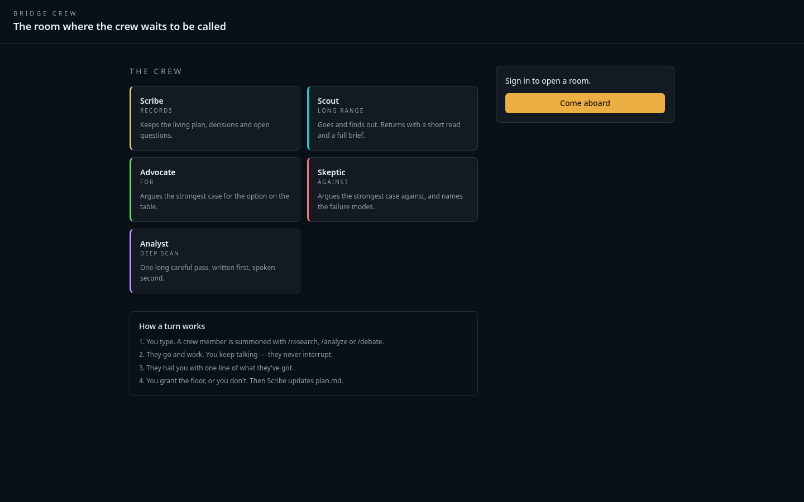
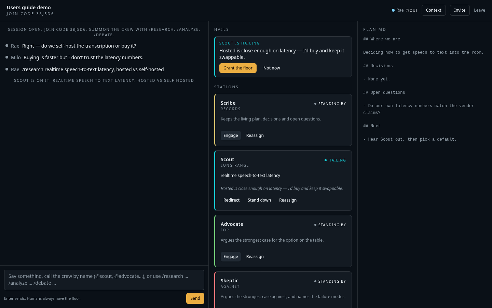
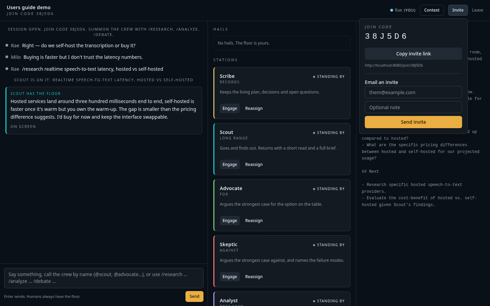
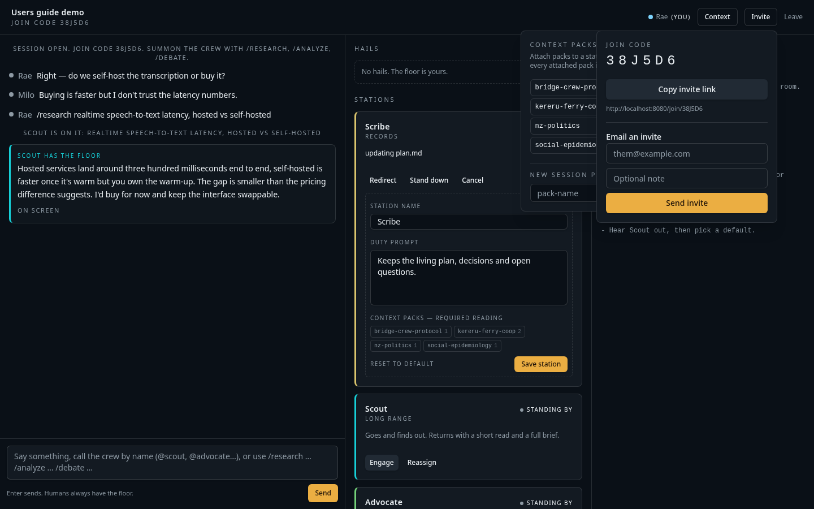
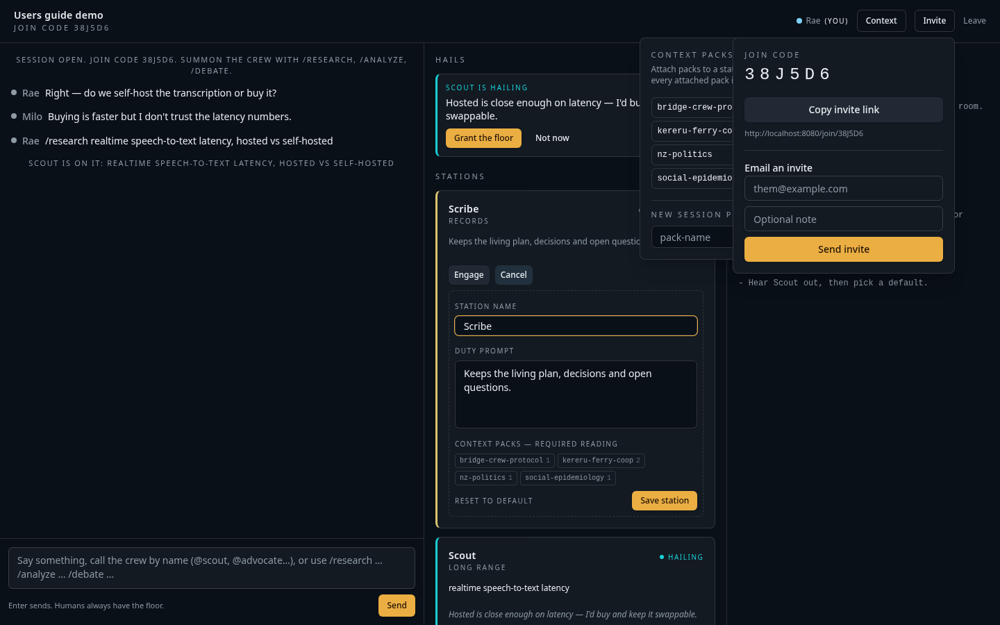
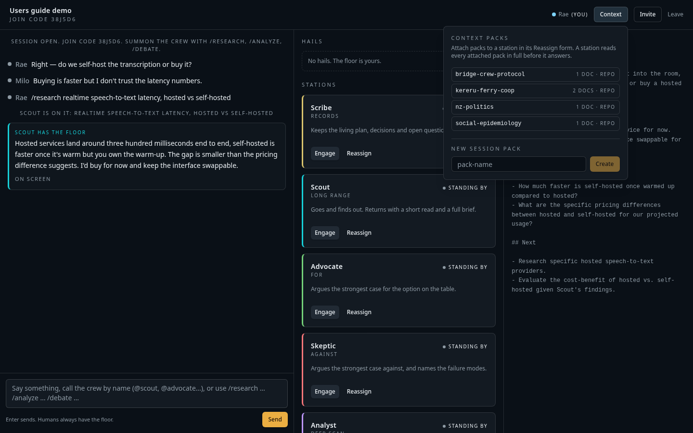

# Bridge Crew — users guide

Bridge Crew is a room where people work with a crew of AI characters. The people type, the crew
works in the background, and nobody in the crew speaks until a person grants them the floor.
There are two kinds of room:

| Room | Who | For | Read |
| --- | --- | --- | --- |
| **Game Studio** | A teacher and a student, sharing one laptop | Making a small browser game | [Part 1](#part-1-the-game-studio) |
| **Deliberation** | Two people, each at their own computer | Working through a plan or a debate | [Part 2](#part-2-deliberation-rooms) |

Both run on your own computer. The crew's replies come from Claude, an AI model made by
Anthropic.

**Part 1, the Game Studio:** [1. Install it on a Mac](#1-install-it-on-a-mac) ·
[2. Start a session](#2-start-a-session) · [3. In the Game Studio](#3-in-the-game-studio) ·
[4. Making the game](#4-making-the-game) ·
[5. Stopping, updating and fixing](#5-stopping-updating-and-fixing)

**Part 2, Deliberation rooms:** [6. Sign in](#6-sign-in) · [7. Open a room](#7-open-a-room) ·
[8. Invite the second human](#8-invite-the-second-human) · [9. Talk](#9-talk) ·
[10. Summon the crew](#10-summon-the-crew) · [11. Grant the floor](#11-grant-the-floor) ·
[12. Reassign a station](#12-reassign-a-station) · [13. Context packs](#13-context-packs) ·
[14. Demo room](#14-demo-room) · [15. Leaving and coming back](#15-leaving-and-coming-back)

---

## Part 1: The Game Studio

The Game Studio is for one teacher and one student, making a small browser game together on
the teacher's laptop, with a crew who play the jobs of a game studio. The student is the
producer: they ask the crew for things and decide what goes into the game. The teacher's side
of a session is in the [teacher's guide](teachers_guide.md).

### 1. Install it on a Mac

You do this once, on the laptop you'll use for lessons. It takes 20 to 30 minutes, most of it
downloading, and you don't need to know the command line. You need:

- a Mac with macOS 13 (Ventura) or later, 16 GB of memory, and about 15 GB of free disk space;
- to be signed in to an account on it that can install software (an administrator account);
- an Anthropic API key, which the next part explains.

#### Get an Anthropic API key

An API key is a long password, starting `sk-ant-`, that lets Bridge Crew use Claude. Anthropic
charges the account the key belongs to for what the crew uses, so that account needs credit.

1. Go to <https://platform.claude.com/settings/keys>, and sign up or sign in.
2. Under **Billing**, add a payment method and buy some credit.
3. Under **API keys**, press **Create Key**, name it "Game Studio", and copy the key. Anthropic
   shows it only once, so keep it somewhere safe, such as a password manager.

Treat the key like a password: don't email it, and don't paste it anywhere except the
installer. **Usage** in the same console shows what each day cost, and **Limits** can cap
monthly spending. If someone else pays for your lessons, they can invite you to their Anthropic
organization, and you make the key there.

#### Run the installer

1. Open **Terminal**: press ⌘-Space, type `Terminal`, and press Return.
2. Copy this line, paste it into Terminal, and press Return:

   ```
   /bin/bash -c "$(curl -fsSL https://raw.githubusercontent.com/richbodo/bridge-crew/main/scripts/install-mac.sh)"
   ```

3. Follow what it says. It:
   - installs Homebrew, which asks for the password you use to log in to the Mac (nothing shows
     on screen as you type it), and then the tools Bridge Crew needs;
   - downloads Bridge Crew into a folder called `bridge-crew` in your home folder;
   - asks for your API key. Paste it and press Return; it doesn't show on screen. The installer
     checks the key with Anthropic and saves it on the laptop only;
   - starts the local database once, which downloads about 2 GB;
   - puts **Game Studio** and **Bridge Crew Games** on your Desktop. If the Mac asks whether
     Terminal may use your Desktop folder, click **Allow**.
4. When it says **All set**, it offers to start the Game Studio. Press Return to try it.

If the installer stops, it says why. Fix that, then paste the same line again: it carries on
from where it stopped.

### 2. Start a session

1. Double-click **Game Studio** on the Desktop. A Terminal window opens and starts everything.
   After the Mac has been restarted, this takes a minute or two.
2. The Game Studio opens in your browser. Click **Log me on as demo user 1**: that's you, the
   teacher. The student doesn't get an account.
3. **Game Studio** is already picked. Type your name, the student's **nickname** (never their
   real name) and a title for the game, then press **Open a room**. A Game Studio room has one
   seat, so there's no invite.
4. Read the **classroom notice** together, then press **We've read it**.

Keep the Terminal window open during the session. The Game Studio only answers on this laptop,
not to other computers on the same Wi-Fi. Next time, open the same room from **Recent rooms**
in the lobby and carry on.

Developers can run `just game-studio` instead ([dev_setup.md](dev_setup.md)). Unlike the Desktop
shortcut, it also answers to other computers on the network.

### 3. In the Game Studio

- **The classroom notice** opens every time the room does. "These are AI characters, and they
  can be wrong" stays under the header.
- **The crew** has six jobs: Storyteller, Game designer, Artist, Sound designer, Engineer and
  Tester. Every crew member reads the `game-studio` context pack.
- **Avatars.** A small pixel portrait beside each crew member's name shows what it's doing.
  Standing by, it's still. Working, it uses its tool: the Storyteller writes in a book, the Game
  designer tries a joystick, the Artist (a friendly alien) paints, the Sound designer's notes
  rise, the Engineer pulls its goggles down, and the Tester (a robot) looks through a magnifying
  glass. Hailing, it puts a hand up under a yellow "!", on its card, on its hail, and in the
  strip under the big screen. Only a crew member that's working or hailing moves, and nothing
  moves if the computer is set to reduce motion.
- **Who's talking.** The switch above the message box says whether a prompt is the student's or
  the teacher's, and the crew sees which. It starts on the student.
- **Asking a crew member.** Start with their name and a comma, like "Artist, draw the mole", or
  put `@` before it anywhere. A name in the middle of a sentence is just a word. There are no
  slash commands.
- **Answers.** A crew member works, then hails. Nothing is said until someone presses **Grant
  the floor**; **Not now** declines. Spoken parts are at most three sentences; the full detail
  is in the brief. Under each line, **Reply**, **How did you do that?** and **Show detail** are
  separate buttons. Show detail opens the brief, formatted.
- **Asking a crew member to ask another.** Crew members can't start each other's work, but they
  can suggest it: "Game designer, get the sounds for catching a ladybug from the Sound
  designer." Once the student grants the hail, the suggestion appears under **Suggestions**:
  "Game designer suggests: Ask the Sound designer: …". **Yes** asks them; **No thanks** doesn't.
  A suggestion lapses when the same crew member speaks again.
- **Back asks first.** In a Game Studio room, the browser's Back button (or a two-finger swipe
  on the trackpad) asks "Leave the studio?" before it goes. **Leave**, in the header, doesn't
  ask.
- **`game.md`** is the game's design notes, kept by the Scribe in the background. It only
  writes down what the student said yes to, and the Engineer will build from it.
- **Safety settings.** Every crew member follows rules for young people: short literal
  sentences, nothing unsuitable for 13 and over, no personal questions, and no judging the
  student. A request the model declines stays declined.

### 4. Making the game

- **What the crew makes.** The Engineer makes **versions** of the game, each one a single HTML
  file. The Artist makes **pictures**, and the Sound designer makes **sounds**. Whatever a crew
  member makes comes with its hail.
- **Nothing goes into the game until the student says yes.** Granting the hail puts it in the
  game, and a version becomes the **current version**: the one the Engineer builds from next.
  **Not now** leaves it **not used**, but it isn't lost.
- **Made in this room**, in the right column under `game.md`, lists everything, newest first,
  with what happened to it. **Use this** puts something that wasn't used into the game, or makes
  an older version current again. **Play** plays a sound; nothing plays on its own.
- **Manage**, beside that list and on the big screen, renames things and removes the ones you
  don't need. A version can get a title, as in "Version 3: with gems". **Remove** takes a thing
  out of the lists and out of what the crew builds with, but deletes nothing: **Removed** at the
  bottom of Manage has **Put back**, and every version stays in the games folder. The current
  version can't be removed; use another version first.
- **Asking a crew member to tidy up.** "Artist, remove the old mole pictures." The crew member
  lists what it would remove with its hail ("Removes, if you grant it"), and only removes it if
  the student grants it. A crew member only removes things it made.
- **On screen and Off screen.** **On screen** shows one thing, large: the game (playable), a
  picture, the sounds, or what a crew member said. Press **On screen** on anything or in the
  header, or just type "on screen". "Off screen" comes back to the bridge. **Full screen** fills
  the laptop's display, and **Esc** comes back. A strip under the big screen keeps the message
  box, the newest hail and any suggestions to hand.
- **When a version crashes** on screen, the room says so and suggests "Ask the Engineer to fix
  it?" **Yes** starts the Engineer on it; **No thanks** leaves it.
- **Reply**, under a crew member's line, starts a prompt to them about what they said, with the
  cursor in the message box. **How did you do that?** asks them to explain how they made it,
  step by step, without changing anything.
- **Briefs not said**, under the hails, keeps every brief that was declined, replaced, stopped
  or superseded, with Reply and How did you do that? on each.
- **Saving and sharing.** Every version is saved on the laptop the moment it's made, in the
  games folder, **Bridge Crew Games** on the Desktop: `v1.html`, `v2.html` and so on, with
  `index.html` as the current version. **Download** saves a version wherever you like. Each
  file opens in any browser, even offline, so the teacher can email it to the family.
- **Delete room** also deletes the room's games folder.

### 5. Stopping, updating and fixing

- **Stopping.** Press **Control-C** in the Game Studio's Terminal window. It stops the Game
  Studio and the database it started, then says **Stopped**, and you can close the window.
  Everything is saved.
- **Updating.** Paste the install line into Terminal again. It updates Bridge Crew and keeps
  your rooms, games and key.
- **Changing the key.** Paste the install line again, and paste the new key when it asks.
- **"The crew could not reach the model."** The laptop is offline, or Anthropic is busy. Check
  the Wi-Fi, then ask again.
- **"The model provider rejected the crew's API key"** or **"AI credits are exhausted for this
  account."** Check **Billing** at <https://platform.claude.com/settings/billing>, then paste
  the install line again: it checks the key.
- **The browser can't connect to localhost.** The Game Studio isn't running. Double-click
  **Game Studio** on the Desktop; if it's already running, that opens it again.
- **A crew member stays working for a long time.** After five minutes it stops by itself. You
  can also press **Stand down** on its card.
- **Anything else.** The last lines in the Terminal window usually say what went wrong.
  Restarting the Mac and double-clicking **Game Studio** fixes most things. A developer can use
  the troubleshooting section of [dev_setup.md](dev_setup.md).
- **Removing it.** Delete the `bridge-crew` folder in your home folder and the two shortcuts on
  the Desktop. The games stay in `Bridge Crew Games` in your home folder until you delete that
  too.

---

## Part 2: Deliberation rooms

A Deliberation room is for two people, each at their own computer, working through a plan or a
debate with five crew members. The people type, the crew works in the background, and nobody
in the crew speaks until a person grants the floor. Running one is set up by a developer, with
[dev_setup.md](dev_setup.md).

### 6. Sign in

Open the app and choose **Come aboard**. Sign up with email and password (confirm the link
in your inbox — check spam the first time). You land in the lobby.

On a local copy started with `just demo`, the lobby and sign-in page also offer **Log me on
as demo user 1** and **Log me on as demo user 2**: one click, no password or email. Each
browser tab keeps its own sign-in, so two tabs can be the two humans in one room. See
[dev_setup.md](dev_setup.md#demo-mode).



The lobby shows the crew roster, a form to open a room, a join-by-code box, and your recent
rooms.

### 7. Open a room

1. Pick the **kind of room**:
   - **Deliberation**: two people work through a plan or a debate with five crew members. The
     rest of this part describes it.
   - **Game Studio**: one teacher and one student make a browser game. See
     [Part 1](#part-1-the-game-studio).
2. Type **your name in the room** (this is what the other human sees next to your colour dot).
3. Pick a colour.
4. Give the session a **title**.
5. Press **Open a room** — or **Open a demo room** to get a pre-filled example (see §14, Demo
   room).

You are dropped straight into the room and the header shows the **join code**.



The room has three columns:

| Column | What it is |
| --- | --- |
| Left | The conversation and your message box |
| Middle | **Hails** (agents asking to speak) and the **stations** |
| Right | `plan.md`, the living document the Scribe maintains |

### 8. Invite the second human

Click **Invite** in the header. You can:

- **Copy invite link** — a `/join/<CODE>` URL you paste into any chat, or
- **Email an invite** — enter their address plus an optional note.

The other person signs in, picks their own name and colour, and joins the same room.
They can also type the six-character code into the lobby's **Join with a code** box.
A Deliberation room has two seats: a third person who tries to join is told the room is full.



### 9. Talk

Type in the box at the bottom left and press **Enter** (Shift+Enter for a new line).
Everything you and the other human say is visible immediately to both of you and is read by
every agent you summon afterwards.

### 10. Summon the crew

Three ways, all equivalent:

**Slash commands**

| Command | Effect |
| --- | --- |
| `/research <topic>` | Sends Scout to go and find out |
| `/analyze <thing>` | Sends the Analyst for a deep scan |
| `/debate <question>` | Sends Advocate *and* Skeptic on opposite sides |
| `/scribe <brief>`, `/scout …`, `/advocate …`, `/skeptic …`, `/analyst …` | Summons that one station |
| `/redirect <station> <new brief>` | Replaces what a working station is doing |
| `/stop <station>` | Stops a station, wherever it is |

**Naming them in ordinary speech** — put `@` before a name anywhere (`what did the vendor docs
say, @scout?`), or start with the name and a comma or colon (`Scout, what did the vendor docs
say?`). That re-engages Scout with the whole line as the brief. Several `@` names in one line
engage several stations. A name in the middle of a sentence without the `@` is just a word, so
"I asked the scout" summons nobody.

**Station buttons** — each card has **Engage** (or **Redirect** when it's already working),
**Stand down**, and **Reassign**.

Stations move through four states: `standing by` → `working` → `hailing` → `on the floor`.
Only one station can hold the floor at a time. Summoning a station that's already working
redirects it: it drops the old task, and only the new one comes back. Summoning one that's
hailing replaces its hail with new work; the old brief stays readable. **Stand down** (or
`/stop`) stops a station wherever it is and withdraws its hail. The full state machines are in
[state_machines.md](state_machines.md).

The crew's work happens on the server, so you can close the tab mid-run and the hail will be
waiting when you come back. **Send** never greys out: while stations work, the line under the
box says who's at work, and you can keep talking.

### 11. Grant the floor

When an agent has something, it raises a hand and one line of what it's got appears under
**Hails**. Nothing is said in the room until you press **Grant the floor** — or **Not now** to
dismiss it.

A granted turn is short (capped at ten sentences). Anything longer goes into the written
brief: press **Show detail** under the agent's line to read it, **Hide detail** to fold it away.



Either human can grant or dismiss any hail. A human typing always preempts a speaking agent.
If a grant can't happen, the message says why: another station is speaking, the hail was
already answered, or the station has moved on to newer work.

### 12. Reassign a station

Press **Reassign** on any card to change:

- **Station name** — e.g. rename Scribe to `Bug_Reporter`
- **Duty prompt** — what that station is for, in your words
- **Context packs** — required reading (see §13)

Save with **Save station**, or use **Reset to default** to put the stock crew member back.
Changes apply to the next run and are visible to both humans.



### 13. Context packs

A context pack is a named folder of documents a station must read **in full** before it
answers. Open **Context** in the header to see what's available.



- **Repo packs** ship with the app: `bridge-crew-protocol`, `kereru-ferry-coop`,
  `nz-politics`, `social-epidemiology`. They contain deliberately obscure facts, so you can
  tell from an answer whether the pack was actually read.
- **Session packs** are created here and live only in this session.

Attach packs to a station in that station's **Reassign** form; attached packs show as chips on
the card. Every run, an agent receives: its duty, the conversation so far, the current
`plan.md`, and every attached pack.

### 14. Demo room

**Open a demo room** in the lobby creates a normal room pre-loaded with a short scripted
scene: two humans debating hosted vs. self-hosted speech-to-text, a `/research` summon, a
Scout hail waiting for you, and a starter `plan.md`.

**What works in a demo room** — everything a normal room does:

- Granting the floor to the pre-loaded Scout hail (Scout speaks, Scribe then updates `plan.md`)
- Typing, summoning, redirecting and standing down stations, with live model answers
- Reassigning stations, attaching context packs, creating session packs
- Inviting a second human by link, code, or email
- Real-time sync between both humans' browsers

**What is not real in a demo room:**

- The opening four lines and Scout's first contribution are **canned text**, not model output —
  "Rae" and "Milo" are not real participants and never reply
- The pre-loaded hail's brief was written by hand, so it cites no live sources
- The seeded `plan.md` was written by hand, not by the Scribe (the Scribe overwrites it on its
  next run)
- No context pack was read for that first canned answer

Everything you do *after* opening the demo room is real. To start clean, leave and use
**Open a room** instead.

### 15. Leaving and coming back

**Leave** returns you to the lobby; the room keeps its state. Your recent rooms are listed in
the lobby sidebar — reopen one and the whole conversation, stations, and plan are as you left
them.

**Delete room**, in the header, removes the room and everything in it for good. Only the person
who opened the room sees it, and it asks first.

---

## Not built yet

Voice and video, session export bundles, and agent tool use are on the plan
([BRIDGE_CREW_PLAN.md](plans/BRIDGE_CREW_PLAN.md)) but not in the app today. Everything above
is text-first. The Game Studio's own list is at the end of the
[teacher's guide](teachers_guide.md#not-built-yet).
